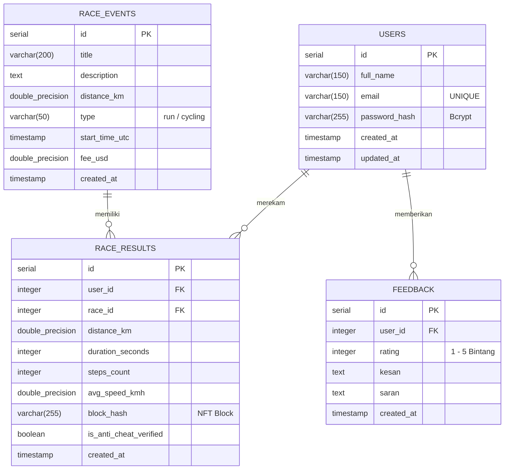

# Backend REST API & PostgreSQL Database - Global Virtual Race
> Implementasi **BL-01 (Backend & DB)** dan **BL-02 (Autentikasi Bcrypt & JWT)**

Dokumentasi arsitektur REST API server dan skema relasional PostgreSQL untuk platform kompetisi virtual atletik *Global Virtual Race*.

---

## 1. Arsitektur & Teknologi (BL-01 & BL-02)

- **Runtime**: Node.js (Express.js Framework)
- **Database Engine**: PostgreSQL 18
- **Konektor DB**: `pg` (Node-Postgres Connection Pooling)
- **Password Security**: `bcryptjs` (Salt Rounds = 10, tanpa Firebase)
- **Session & Token**: `jsonwebtoken` (JWT Bearer Token Authentication)
- **CORS & Environment**: `cors`, `dotenv`

---

## 2. Entity Relationship Diagram (ERD)



---

## 3. Endpoints REST API

### A. Autentikasi (`/api/auth`)
| Metode | Endpoint | Akses | Deskripsi |
|---|---|---|---|
| `POST` | `/api/auth/register` | Publik | Registrasi akun baru, hashing Bcrypt, mengembalikan JWT |
| `POST` | `/api/auth/login` | Publik | Verifikasi password hash Bcrypt, menerbitkan JWT |
| `GET` | `/api/auth/profile` | Protected (`Bearer JWT`) | Mengambil data profil user beserta total KM & medali |

### B. Event Kompetisi (`/api/events`)
| Metode | Endpoint | Akses | Deskripsi |
|---|---|---|---|
| `GET` | `/api/events` | Publik | Mengambil daftar lomba (jarak, tipe lari/sepeda, jadwal) |
| `POST` | `/api/events/results` | Protected (`Bearer JWT`) | Menyimpan hasil lari terverifikasi sensor anti-cheat & NFT |

### C. Saran & Kesan (`/api/feedback`)
| Metode | Endpoint | Akses | Deskripsi |
|---|---|---|---|
| `GET` | `/api/feedback` | Publik | Mengambil daftar ulasan, rating, dan saran peserta |
| `POST` | `/api/feedback` | Publik / Auth | Mengirim feedback rating bintang, kesan lintasan, dan saran |

---

## 4. Cara Menjalankan Backend

1. **Instalasi Dependensi**:
   ```powershell
   cd backend
   npm install
   ```

2. **Inisialisasi Database & Seeding Tabel (Otomatis)**:
   ```powershell
   node src/database/initDb.js
   ```

3. **Menjalankan Server**:
   ```powershell
   npm start
   # Server berjalan di http://localhost:5000
   ```
